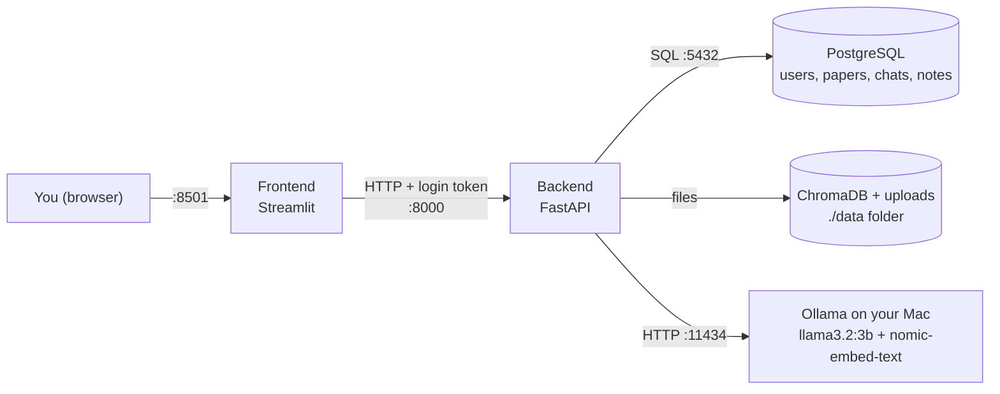
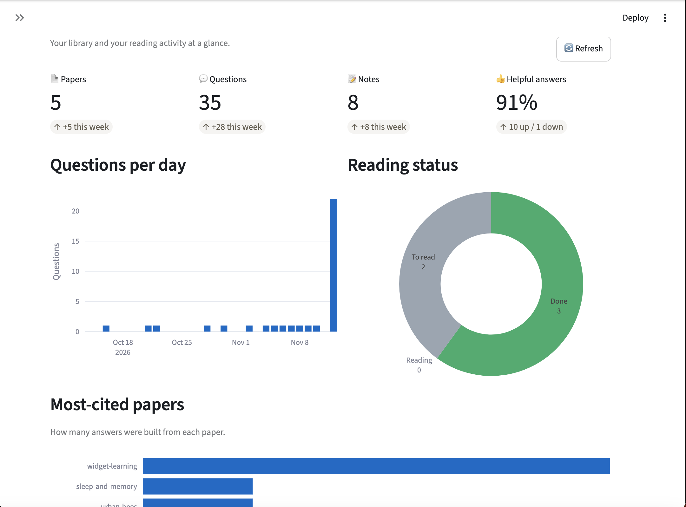
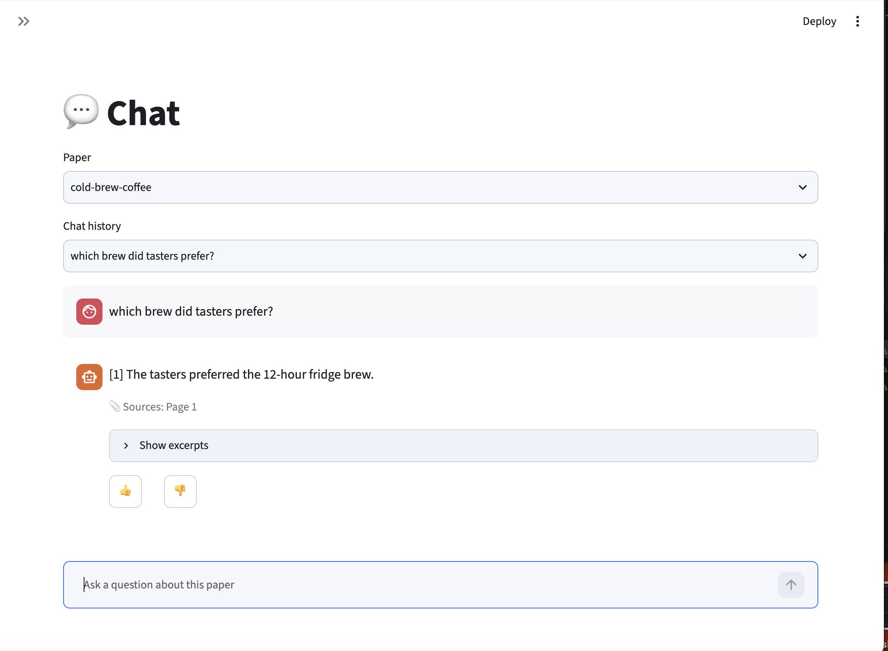
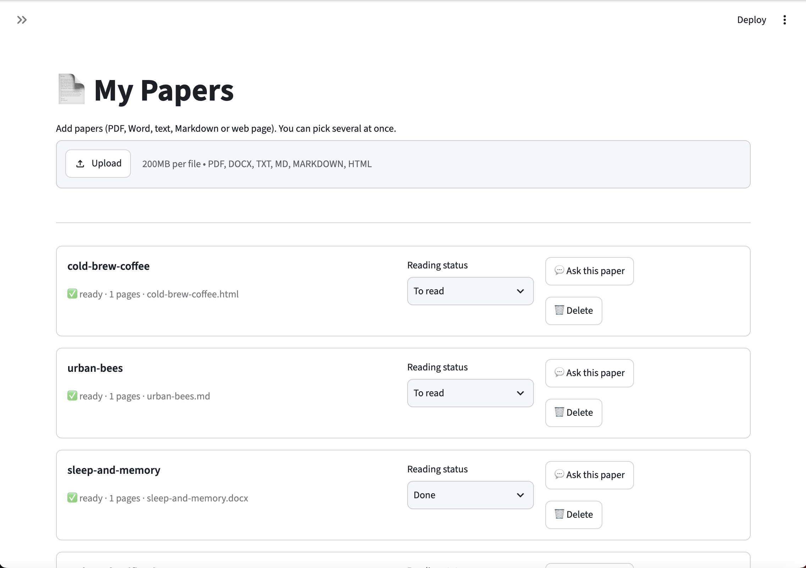
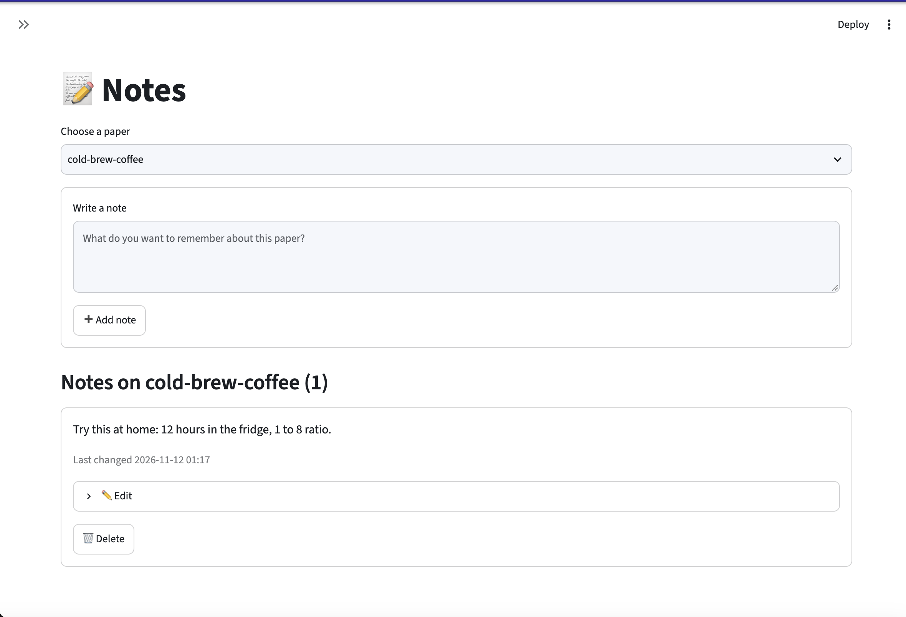

# 📄 Accument

**Accument is a reading helper for research papers.** Upload a paper (PDF, Word, text, Markdown or web page), ask it questions in plain English, and get answers that point to the exact page they came from. The AI runs on your own computer through Ollama, so your papers never leave it, and a single command (`docker compose up`) starts the whole system.

**Contents:** [Architecture](#architecture) · [Prerequisites](#prerequisites) · [Setup](#setup) · [Usage guide](#usage-guide) · [API endpoints](#api-endpoints) · [Tech stack](#tech-stack) · [Testing](#testing) · [Design decisions](#design-decisions) · [Limitations and future work](#known-limitations-and-future-improvements) · [Screenshots](#screenshots) · [Troubleshooting](#troubleshooting)

| Page | What it does |
| --- | --- |
| 📊 Dashboard | Your library at a glance: stat cards, questions per day, reading progress, most-cited papers, notes per paper, and your latest questions (click one to jump back into that chat) |
| 📄 My Papers | Upload papers (several at once), mark each as *To read / Reading / Done*, delete |
| 💬 Chat | Ask questions; the answer **streams in word by word**, with page references and 👍/👎 |
| 📝 Notes | Pick a paper, then add, edit or delete as many notes as you like |
| 🔀 Compare | Ask one question across 2-4 papers |
| 📑 Summaries | Short, key-points or plain-English summaries |
| 🔧 Settings | A health check that tells you exactly what to fix if something isn't switched on |

---


## Project layout

```
accument/
├── docker-compose.yml      three boxes: db, backend, frontend
├── .env.example            copy to .env
├── backend/
│   ├── app/
│   │   ├── api/            the endpoints (auth, papers, chat, notes, compare, summaries, stats, health)
│   │   ├── core/           database, models, schemas, security
│   │   ├── repositories/   all database reading and writing lives here
│   │   └── services/       file parsing, chunking, search, the AI writer, ingestion
│   ├── alembic/            database change log (001, 002, 003)
│   ├── evals/              search and answer quality checks
│   ├── scripts/            demo data
│   └── tests/              unit and API tests
├── frontend/
│   ├── Home.py             the menu and Log out button
│   ├── views/              one file per page
│   └── api_client.py       the only file that talks to the backend
└── docs/screenshots/       images used in this README
```


---

## Architecture

Accument is three programs that start together (Docker Compose), plus Ollama, which runs directly on your Mac. Think of a restaurant: the **website** is the dining room, the **backend** is the kitchen, the **database** is the pantry, and **Ollama** is the chef.



| Service | Port | Job |
| --- | --- | --- |
| `frontend` | 8501 | The website. Shows pages and talks only to the backend |
| `backend` | 8000 | All the rules: login, reading papers, search, asking the AI, saving results |
| `db` | 5432 | PostgreSQL, the filing cabinet. Its data lives in the `pgdata` volume, so it survives restarts |
| Ollama (outside Docker) | 11434 | Runs the AI models. It sits outside Docker because it is much faster on your Mac's own hardware |

**How a question is answered** (the "open-book exam"):

1. **You ask** a question about one paper.
2. **Two searchers** look through that paper: one finds passages that *mean* the same thing (ChromaDB), the other finds passages with the same *words* (BM25). Their results are merged, like a restaurant that two different friends both recommend.
3. The best passages are numbered **[1], [2]...** and handed to the AI with one rule: *answer only from these*.
4. The AI's words **stream** back to your screen as they are written.
5. Any citation number the AI invented is **deleted**, and if the paper doesn't contain the answer, you are told so instead of getting a guess.
6. The finished answer, its sources, how long it took and how many tokens it used are saved.

---

## Prerequisites

| You need | Why | Notes |
| --- | --- | --- |
| **Docker Desktop** (with Compose v2) | Runs the database, backend and website | Must be open and running |
| **Ollama** | Runs the AI models on your computer | Download from ollama.com. Must be open (llama icon in the menu bar) |
| **Python 3.11** (3.12 also works) | Only for running tests and for editor support. The app itself runs inside Docker with Python 3.11 | Very new versions (such as 3.14) can lack ready-made packages for some AI libraries |
| About **5 GB** free disk and **8 GB RAM** (16 GB recommended) | The AI models are large | Everything runs without a graphics card, just slower |

---

## Setup

**1. Get the code and open its folder.**
```bash
git clone https://github.com/AlecatWork/accument.git
cd accument
```

**2. Give Ollama the two models it needs** (once).
```bash
ollama list                      # see what you already have
ollama pull nomic-embed-text     # the "search by meaning" model
ollama pull llama3.2:3b          # the chat model (any model from `ollama list` works)
```

**3. Create your settings file** (once).
```bash
cp .env.example .env
```
Open `.env`, make sure `MODEL_NAME` matches a name shown by `ollama list`, and change `JWT_SECRET` to a long random sentence. All settings are listed below.

**4. Start everything.**
```bash
docker compose up --build
```
The first build takes a few minutes. The backend updates the database by itself on start. When the logs settle, open **http://localhost:8501**.

**5. (Recommended) Add demo data** so you can ask questions without uploading anything. In a second Terminal tab:
```bash
docker compose exec backend python -m scripts.seed_demo_data
```
Then log in with **demo@example.com / demodemo123**. You get five fictional sample papers (two PDFs, one Word file, one Markdown file, one web page) plus notes, past chats and thumbs, so every dashboard chart has something to show.

**Stop it:** `docker compose down` (your data is kept). Add `-v` only if you want to wipe the database.

<details>
<summary><b>All settings (<code>.env</code>)</b></summary>

| Variable | Default | Meaning |
| --- | --- | --- |
| `MODEL_NAME` | `llama3.2:3b` | Chat model; must appear in `ollama list` |
| `EMBED_MODEL` | `nomic-embed-text` | Model that turns text into "meaning numbers" |
| `OLLAMA_URL` | `http://host.docker.internal:11434` | Where Docker finds Ollama on your Mac |
| `OLLAMA_TIMEOUT` | `300` | Seconds to wait for the AI (older laptops are slow) |
| `DATABASE_URL` | Postgres in Compose | Where the database lives |
| `JWT_SECRET` | *(change me)* | Secret used to sign login tokens |
| `JWT_EXPIRE_MINUTES` | `10080` | Logins last 7 days |
| `MAX_UPLOAD_MB` | `25` | Largest allowed upload |
</details>

---

## Usage guide

### Ingest documents (add papers)

- **In the website:** open **📄 My Papers**, choose one or more files, and click **➕ Add papers**. Supported: PDF, Word (`.docx`), text (`.txt`), Markdown (`.md`) and web pages (`.html`). Reading a paper takes from a few seconds to a few minutes, then it shows **✅ ready**.
- **Demo data:** run the seed command in [Setup](#setup).
- **Through the API:**
  ```bash
  # 1. create an account and keep the token
  TOKEN=$(curl -s -X POST localhost:8000/auth/signup -H 'content-type: application/json' \
    -d '{"email":"you@example.com","password":"a-long-password"}' | python3 -c "import sys,json; print(json.load(sys.stdin)['access_token'])")
  # 2. upload a paper
  curl -X POST localhost:8000/papers -H "Authorization: Bearer $TOKEN" -F "file=@my-paper.pdf"
  ```

### Ask questions

1. Open **💬 Chat**, pick a paper and **➕ New chat**, and type a question. The answer streams in, with **[1]** markers.
2. Under each answer, **📎 Sources** lists the pages used, and **Show excerpts** reveals the exact passages.
3. Follow-up questions in the same chat remember what was said earlier.
4. If the paper doesn't contain the answer, you get *"I can't find that in the paper."* on purpose.
5. Use 👍/👎 to rate answers. The **Dashboard** shows your ratings.

### The other pages

- **📝 Notes:** pick a paper, **➕ Add note**, then **✏️ Edit** or **🗑️ Delete** any note. A paper can have many notes.
- **📄 My Papers:** set each paper's **Reading status**, or **🗑️ Delete** it (this also removes its chats, notes and summaries).
- **🔀 Compare** and **📑 Summaries:** pick papers, type a question or choose a style, and click the button.
- **🚪 Log out** is under the menu on every page. The interactive API docs are at **http://localhost:8000/docs**.

---

## API endpoints

Protected endpoints need the header `Authorization: Bearer <token>` (you get the token from signup or login). Every endpoint checks that the paper, chat or note belongs to you.

| Method | Path | Description | Auth |
| --- | --- | --- | --- |
| GET | `/health` | Database, Ollama and model status | No |
| POST | `/auth/signup` | Create an account, returns a token (10/min limit) | No |
| POST | `/auth/login` | Log in, returns a token (10/min limit) | No |
| GET | `/auth/me` | Who am I? | Yes |
| GET | `/papers` | List your papers | Yes |
| POST | `/papers` | Upload a paper (PDF, DOCX, TXT, MD, HTML); reads, chunks and indexes it (8/min limit) | Yes |
| GET | `/papers/{id}` | One paper | Yes |
| PATCH | `/papers/{id}` | Set reading status: `to_read`, `reading`, `done` | Yes |
| DELETE | `/papers/{id}` | Delete a paper and everything attached to it | Yes |
| POST | `/chat/ask` | Ask a question, get the whole answer at once (20/min limit) | Yes |
| POST | `/chat/ask/stream` | Ask a question, answer streams as JSON lines (20/min limit) | Yes |
| GET | `/chat/conversations?document_id=` | Chat history for a paper | Yes |
| GET | `/chat/conversations/{id}` | Messages of one chat | Yes |
| POST | `/chat/messages/{id}/feedback` | Thumbs `up` or `down` on an answer | Yes |
| POST | `/compare` | Compare 2-4 papers on a question (8/min limit) | Yes |
| POST | `/summaries` | Write a summary: `short`, `key_points` or `simple` (8/min limit) | Yes |
| GET | `/summaries?document_id=` | Saved summaries of a paper | Yes |
| POST | `/notes` | Add a note to a paper | Yes |
| GET | `/notes?document_id=` | Notes on a paper | Yes |
| PUT | `/notes/{id}` | Edit a note | Yes |
| DELETE | `/notes/{id}` | Delete a note | Yes |
| GET | `/stats` | Everything the dashboard shows | Yes |

---

## Tech stack

| Area | Technology |
| --- | --- |
| Frontend | Streamlit, Plotly, pandas |
| Backend | Python 3.11, FastAPI, Pydantic (data checking) |
| Database | PostgreSQL 16, SQLAlchemy 2 (database access), Alembic (database change log) |
| AI and search | Ollama (`llama3.2:3b` for answers, `nomic-embed-text` for meaning), ChromaDB (search by meaning), rank-bm25 (search by words) |
| File reading | PyMuPDF (PDF), python-docx (Word), Python's built-in HTML reader |
| Security | JWT login tokens (PyJWT), Argon2 password scrambling, SlowAPI rate limiting |
| Running it | Docker, Docker Compose |
| Quality | pytest, Ruff (style checker), GitHub Actions (CI) |

---

## Testing

The test tools live on your computer, not in Docker. Create the project's private toolbox once (use Python 3.11 or 3.12):

```bash
python3 -m venv .venv
source .venv/bin/activate          # run this in every new Terminal tab; the line should start with (.venv)
pip install -r backend/requirements-dev.txt -r frontend/requirements.txt
```

```bash
cd backend  && python -m pytest                       # 43 tests: login, uploads, chat, streaming, notes, privacy, dashboard
cd frontend && python -m pytest                       # 18 tests: every page opens, login and log out work
cd backend  && ruff check app tests evals scripts     # style and mistakes
cd backend  && python -m evals.retrieval_eval         # does search still find the right page? (needs no AI)
```

The tests use a throw-away database and a pretend AI, so they run in seconds and never touch your real data.

**Continuous integration:** `.github/workflows/ci.yml` runs all of the above on every push, builds the Docker images, and **fails the build if the search-quality score drops below 90%**.

### Evaluation results

*Search quality* (11 questions about the sample widget paper; a question passes if the right page is among the top 2 results and contains the answer words):

| Version of keyword search | Score |
| --- | --- |
| Basic BM25 | 82% (9/11) |
| + filler-word removal and word-ending matching ("labels" = "label") | **100% (11/11)** |

This is a small test on one sample paper, so treat it as a regression guard, not a benchmark.

*Full answers* (12 questions through the whole app; needs Ollama and the demo data):
```bash
docker compose exec backend python -m evals.run_eval
docker compose exec backend python -m evals.report      # prints a table you can paste below
```

| Date | Model | Score |
| --- | --- | --- |
| 2026-11-11 | llama3.2:3b | 75% (9/12) |

Speed and token counts for every question are saved in the `query_logs` table (not shown in the app). Check them with:
```bash
docker compose exec db psql -U accument -c "select avg(latency_ms), avg(completion_tokens) from query_logs;"
```

---

## Design decisions

- **Chunk size: 900 characters with 150 overlap.** 900 characters is about 150 words, roughly one or two paragraphs: small enough that search points at a precise spot, big enough to hold a complete idea. The overlap means an idea cut at the boundary appears in both pieces. Six excerpts of this size use about 1,400 of the model's 4,096-token reading window, leaving room for the instructions and recent chat. Cuts are moved back to a space so words are never sliced.
- **Hybrid search (meaning + keywords).** Meaning search finds "how many pictures were used" even when the paper says "500 diagrams". Keyword search is better for exact names, numbers and years. Merging both with Reciprocal Rank Fusion beat either alone. If the meaning model is unavailable, chat still works on keywords.
- **Models: `llama3.2:3b` and `nomic-embed-text`.** Both are free, private and small enough to run on a 16 GB laptop without a graphics card. The trade-off is quality: a small model sometimes misses details (75% on the full evaluation).
- **Guardrails (the app is built to say "I don't know" rather than guess):**
  1. If search finds nothing relevant, the AI is not even asked.
  2. The AI is told to answer only from the numbered excerpts and to give one exact sentence when it can't.
  3. Citation numbers that don't match a real excerpt are removed from the answer.
  4. Common prompt-injection phrases hidden inside papers ("ignore previous instructions...") are blacked out when a paper is read.
  5. Refusals save no sources, so the dashboard's "most-cited" chart only counts answers that were really built from a paper.
  6. If Ollama is off, the user sees a plain-English fix, and the unanswered question is removed from the chat.
- **Streaming answers.** Small models on a laptop take a while to finish, so the answer appears word by word instead of after a long blank wait. The finished answer is cleaned and saved at the end.
- **Ollama outside Docker.** Docker on a Mac can't use the Mac's hardware as efficiently, so Ollama runs natively and the backend reaches it through `host.docker.internal`.
- **PostgreSQL with migrations (not SQLite).** It matches how real products are built and enforces relationships: deleting a paper automatically deletes its chunks, chats and notes. Every database change is a numbered migration (001, 002, 003) that runs automatically on start.
- **"Pretend pages" for non-PDF files.** Word, text, Markdown and HTML files have no real pages, so text is cut into pages of about 2,500 characters. Citations still say *Page N*.
- **Two separate statuses on a paper.** *Processing status* (ready/failed) is about the system; *reading status* (to read/reading/done) is the reader's own bookmark.
- **Evaluations live outside the app.** Quality scores and speed logs are for developers, so they appear in CI and this README, not on the user's dashboard.

---

## Known limitations and future improvements

**Limitations**

- **Scanned PDFs** (pictures of text) can't be read yet; the app says so.
- **Small model, imperfect answers.** The 3B model scored 75% on the full evaluation and can occasionally answer when it should refuse, or miss a detail.
- **Slow on older laptops.** The first answer after a break can take a minute while the model wakes up. Big PDFs are slow to index because each chunk is processed one at a time.
- **Refreshing the browser page logs you out** (the login token lives in the page's session).
- **Non-PDF "pages" are approximate**, and everything was tested mainly on English text.
- **No password reset or email verification.**
- The sample papers are **fictional** and exist only for demos and tests.

**With more time**

- OCR so scanned papers can be read.
- A **re-ranking** step to pick the best excerpts, and rewriting follow-up questions before searching.
- A **hosted-model option** for better answers (the code already has a place for it: `services/llm/hosted.py`).
- Indexing in the background with a progress bar, and faster batch embedding.
- Logins that survive a page refresh, and password reset.
- Search across **all** papers at once, and exporting notes and summaries.
- Cloud deployment.

---

## Screenshots

*Add your own screenshots to `docs/screenshots/` using these file names.*

| Dashboard | Chat with sources |
| --- | --- |
|  |  |

| My Papers | Notes |
| --- | --- |
|  |  |

---

## Troubleshooting

| Symptom | What to do |
| --- | --- |
| Streamlit says **"Can't reach the backend"** | `docker compose logs backend` shows why it stopped. Most often: a typo in `.env`, or the database still starting (wait 20 seconds and refresh) |
| 🔧 Settings shows a red light for a model | Run the `ollama pull ...` command it prints |
| Settings says Ollama is **not reachable** | Open the Ollama app. Then test from Docker: `docker compose exec backend python -c "import urllib.request; print(urllib.request.urlopen('http://host.docker.internal:11434').read())"` should print *Ollama is running* |
| A paper shows **failed** | The red text under it says why (Ollama off, scanned file...). Fix it, delete the paper and upload again |
| The first answer takes a long time | Normal on an older laptop: the model is waking up. A smaller model in `MODEL_NAME` is faster still |
| `pytest: command not found`, or an `httpx2` error | The toolbox isn't switched on: run `source .venv/bin/activate`, and use `python -m pytest` |
| Red underlines in VS Code | Command Palette → *Python: Select Interpreter* → choose the one inside `.venv` |
